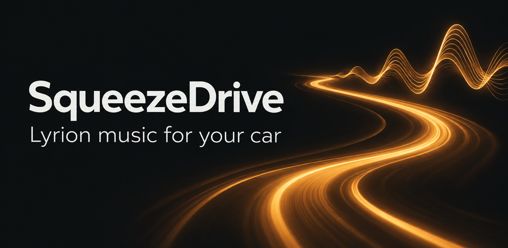

SqueezeDrive brings your Lyrion Music Server library to Android Automotive OS. Browse music and
favourites, start a random mix, and control playback through your car's media interface.

## Features

- Playback through the car's speakers, with a persistent player named **This car**.
- Browsing by artist, album, track, genre and saved playlist.
- Server favourites, including folders and radio streams.
- Random library playback, shuffle and repeat.
- Album artwork, track information, playback progress and queue controls.
- Search and standard media controls, including steering-wheel commands where supported.

The vehicle's media host determines the layout and available controls. Server settings and text
entry are available while parked.

## Getting started

SqueezeDrive runs directly on Android Automotive OS devices with Android 10 or later. Your
Lyrion server must be reachable from the car's network.

Select **SqueezeDrive** in the vehicle's media source picker. While parked, open its settings and
enter your server address and any required credentials. Your settings are saved for future use.

## License

SqueezeDrive is free software under the GNU General Public License, version 3 or later.
It includes code from [Squeeze Client](https://github.com/maniac103/squeezeclient) by Danny Baumann.

See [LICENSE](LICENSE) and [NOTICE](NOTICE) for licensing and attribution.
